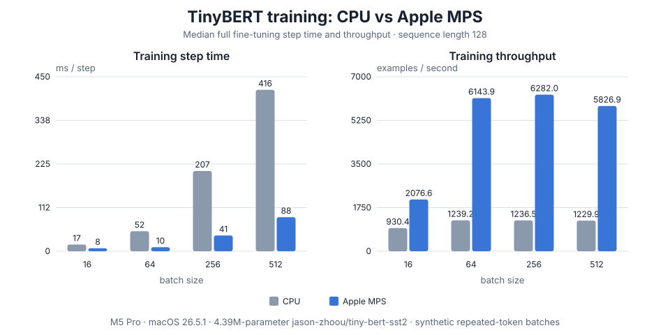

# Apple Silicon (Mac M1 / M2 / M3 / M4 / M5)

flodl supports native macOS execution through PyTorch's MPS backend, as well
as CPU execution in Docker (Linux arm64). CUDA and ROCm are not available on
macOS.

Two halves to keep apart, because `fdl` handles them differently:

- **Managing libtorch** works natively, container build included. In a
  Docker-mounted project, `fdl setup` fetches the **Linux arm64** libtorch
  the container needs — repackaged by `fdl` from the official PyTorch
  wheel — while `fdl libtorch download --cpu` in a native project fetches
  PyTorch's macOS arm64 `.dylib` build. `fdl probe` reports what a host is
  missing with `brew` hints. Both shapes are covered by the OS CI matrix
  (the macOS leg asserts the `.dylib` install and the `--cuda` / `--rocm`
  refusals; the Linux arm leg drives the wheel repackage through
  `fdl setup` itself).
- **Native MPS builds** use the macOS arm64 LibTorch archive and Cargo's
  `mps` feature. Use this path for Apple GPU execution.
- **Docker builds** use Linux arm64 LibTorch and CPU execution. Keep using this
  path for workflows that need Linux parity or CUDA/NCCL clusters.

## Native macOS with MPS

Use an Apple Silicon Mac with macOS 13 or newer, Xcode Command Line Tools,
Rust, and the native macOS arm64 LibTorch archive. From the project root:

```bash
./fdl libtorch download --cpu
export LIBTORCH_PATH="$PWD/libtorch/precompiled/cpu-macos"
export DYLD_LIBRARY_PATH="$LIBTORCH_PATH/lib${DYLD_LIBRARY_PATH:+:$DYLD_LIBRARY_PATH}"
cargo test -p flodl --features mps test_mps_forward_backward
```

Applications that depend on floDl should enable the feature and select
`Device::MPS` when `mps_available()` returns `true`:

```rust
use flodl::{mps_available, Device, Tensor};

if mps_available() {
    let x = Tensor::from_f32(&[1.0, 2.0], &[2], Device::MPS)?;
}
```

The `mps` feature is supported only on Apple Silicon macOS and cannot be
combined with the `cuda` or `rocm` Cargo features. MPS has one device, exposed
as `Device::MPS` (index 0). CUDA streams, CUDA graphs, and NCCL collectives
remain CUDA-only; unsupported PyTorch MPS operators may fail at runtime.
`fdl` does not yet select the `mps` Cargo feature automatically, so enable it
in your Cargo command or dependency configuration.

### CPU vs MPS training benchmark

The checked-in benchmark runs full forward, loss, backward, and AdamW steps
for a 4.39-million-parameter TinyBERT sequence classifier on CPU and MPS. It
uses batch sizes 16, 64, 256, and 512 at sequence length 128. Each device gets
two warmup steps and three timed rounds of ten steps; the reported step time
is the median round, with device synchronization around each timed round.
Model loading and tokenization are outside the timed region.

Run it from the repository root on an Apple Silicon Mac:

```bash
export LIBTORCH_PATH="$PWD/libtorch/precompiled/cpu"
export DYLD_LIBRARY_PATH="$LIBTORCH_PATH/lib${DYLD_LIBRARY_PATH:+:$DYLD_LIBRARY_PATH}"
cargo run --release -p flodl-hf --example bert_mps_bench --features flodl/mps
```

The first run downloads the [17.5 MB `jason-zhoou/tiny-bert-sst2` checkpoint](https://huggingface.co/jason-zhoou/tiny-bert-sst2).
The example prints CSV to stdout. The measurements below were collected on an
M5 Pro Mac running macOS 26.5.1; the raw rows are in
[`benchmarks/mps-tinybert.csv`](../benchmarks/mps-tinybert.csv), and
[`benchmarks/plot_mps.py`](../benchmarks/plot_mps.py) regenerates the chart.



| Batch | CPU ms / step | MPS ms / step | MPS speedup | CPU examples / s | MPS examples / s |
| ---: | ---: | ---: | ---: | ---: | ---: |
| 16 | 17.197 | 7.705 | 2.23× | 930 | 2,077 |
| 64 | 51.645 | 10.417 | 4.96× | 1,239 | 6,144 |
| 256 | 207.039 | 40.751 | 5.08× | 1,237 | 6,282 |
| 512 | 416.302 | 87.869 | 4.74× | 1,230 | 5,827 |

This is a controlled throughput test, not an accuracy result: each batch
repeats two short positive/negative token sequences, with alternating labels.
It demonstrates that the full fine-tuning path executes on MPS and measures
this model and workload on this Mac; real-world speedups depend on model,
sequence length, batch size, and MPS operator coverage.

## Docker CPU path

The setup below keeps using Linux arm64 LibTorch and CPU execution. It remains
useful when a Linux build environment is required.

## Prerequisites

- macOS 12+ on Apple Silicon (any M-series chip).
- Docker Desktop or [OrbStack](https://orbstack.dev/) (recommended — lighter,
  faster file sharing). The instructions below assume the Docker CLI works
  (`docker info` succeeds).
- ~2 GB free disk for libtorch + dependency caches, plus the usual cargo
  target directory.

For the Docker path, you do **not** need Rust installed on the host: the dev
container ships its own toolchain. Native builds need Rust and Xcode Command
Line Tools. A native `fdl` binary is auto-downloaded on first `./fdl`
invocation.

## One-time setup

### 1. Run `fdl setup`

```bash
./fdl setup
```

The container needs **Linux arm64** `.so` files, and PyTorch publishes no
`libtorch-linux-aarch64.zip` on `download.pytorch.org/libtorch/` in any
variant — the compiled CPU bits ship inside the PyTorch *wheel* instead
(self-contained: arm_compute + NVPL BLAS/LAPACK). In a Docker-mounted
project, `fdl setup` (and `fdl libtorch download --cpu` under it) fetches
that wheel, repackages `torch/{lib,include,share}` into
`libtorch/precompiled/cpu-aarch64/`, activates it, and builds the `dev`
image. GPU variants stay refused on Linux arm64: the CUDA aarch64 wheel is
not self-contained, and no ROCm build exists there at all.

Sanity checks:

```bash
test -f libtorch/precompiled/cpu-aarch64/include/torch/csrc/api/include/torch/torch.h
ls    libtorch/precompiled/cpu-aarch64/lib/libtorch*.so
du -sh libtorch/precompiled/cpu-aarch64
# expected: libtorch.so + libtorch_cpu.so + libc10.so present, total ~380 MB
```

The CPU directory name carries the platform (`cpu` is the Linux x86_64
reference build, `cpu-aarch64` the Linux arm64 one, `cpu-macos` the host's
`.dylib` build), so container and host builds coexist in one checkout with
nothing moved or symlinked. `fdl` exports the matching `LIBTORCH_CPU_PATH`
to compose, so the container mounts `cpu-aarch64` automatically; only a
direct `docker compose run` (bypassing `fdl`) needs the `.env` override in
the next step.

### 2. Create `.env` for the docker-compose runtime

```bash
cat > .env <<'EOF'
# Throttle cargo's link parallelism. Required on macOS Docker / OrbStack
# where the virtiofs-mounted libtorch directory cannot serve many concurrent
# `ld` lookups — the linker reports `cannot find -ltorch` spuriously.
CARGO_BUILD_JOBS=2

# Host UID/GID so files written into the bind-mount aren't owned by root.
UID=501
GID=20

# Only needed for DIRECT `docker compose run` calls: `fdl` exports this
# per-arch value itself, but compose alone falls back to the x86 default.
LIBTORCH_CPU_PATH=./libtorch/precompiled/cpu-aarch64
EOF
```

Adjust `UID` / `GID` to your account (`id -u` / `id -g`). The `.env` file is
gitignored — it's host-specific.

Those values are all a Mac needs. `.env.example` at the repo root is the
full reference if you want the other compose knobs (libtorch variant overrides,
CUDA image tag, verbosity).

### 3. Build the dev image (if setup did not)

`fdl setup` builds it already; run this only if you skipped that step:

```bash
docker compose build dev
```

This pulls `ubuntu:24.04` (arm64), installs the Rust toolchain, and is
unrelated to libtorch (libtorch is bind-mounted at run time). The image is
small (~2 GB with toolchain) and caches well between rebuilds.

The `cuda` and `bench` services in `docker-compose.yml` require an NVIDIA
runtime and are unusable on a Mac — leave them alone. `docker compose build dev`
only builds the dev service; avoid `docker compose up` (which would try to
start all services).

## Daily use

```bash
./fdl -h           # CLI help (runs natively on macOS arm64)
./fdl api-ref      # framework API reference (no container needed)
./fdl build        # cargo build in the dev container
./fdl test         # cargo test in the dev container
./fdl clippy       # workspace lint
./fdl shell        # interactive bash in the dev container
```

Expected timing on an M-series chip (first run includes deps download and
the C++ shim compile, ~17 s for the libtorch headers alone):

| Command       | First run | Incremental |
| ------------- | --------: | ----------: |
| `fdl build`   |   ~5 min  |     ~2 s    |
| `fdl test`    |  ~10 min  |    ~30 s    |
| `fdl clippy`  |   ~3 min  |     ~5 s    |

## Troubleshooting

### `ld: cannot find -ltorch` during `fdl test`

`CARGO_BUILD_JOBS` is unset or too high. The virtiofs bind-mount can't serve
many parallel `ld` library lookups against libtorch's 244 MB `libtorch_cpu.so`.
Verify `CARGO_BUILD_JOBS=2` is in `.env`, then check it reaches the container:

```bash
docker compose run --rm dev env | grep CARGO_BUILD_JOBS
# CARGO_BUILD_JOBS=2
```

If empty, confirm that `docker-compose.yml` includes `- CARGO_BUILD_JOBS` in
the `dev` service's `environment:` list.

### `fdl setup` finished but `fdl build` still will not link

Your `fdl` (or checkout) predates the wheel repackage. Two earlier
generations of this failure exist in the wild: the oldest forced a Linux
**x86_64** download (right on an Intel Mac, unloadable in a linux/arm64
container), and the next fetched the host's macOS `.dylib` build and
pointed at a manual wheel-extraction recipe that used to live on this
page. Update, then re-run `fdl setup` — it now fetches the Linux arm64
build into `libtorch/precompiled/cpu-aarch64` itself.

### `libtorch_cpu.so: cannot open shared object file`

The container is mounting the wrong directory — macOS `.dylib` files, or
an empty x86-named default. Inspect what's actually mounted:

```bash
docker compose run --rm dev ls /usr/local/libtorch/lib | head
# you want .so files (libtorch.so, libtorch_cpu.so, libc10.so), not .dylib
```

If this was a direct `docker compose run` rather than an `fdl` command,
compose fell back to its x86 default mount; set `LIBTORCH_CPU_PATH` in
`.env` as in step 2. If an `fdl` command did it, check the install:

```bash
ls libtorch/precompiled/cpu-aarch64/lib/libtorch*.so   # must exist
cat libtorch/precompiled/cpu-aarch64/.arch             # platform=linux-aarch64
```

### `error[E0308]: mismatched types ... expected *const u8, found *const i8`

A portability bug, fixed at the source since 0.6.0: `c_char` is `u8` on Linux
aarch64 and `i8` on Linux x86_64, and `flodl-sys` used to hardcode `*mut i8` in
every extern signature returning a C string. Those signatures now say
`*mut c_char`, so on aarch64 the crate simply compiles and no call site needs a
cast of its own. If you hit this error, your checkout predates 0.6.0 — update
rather than adding casts locally.

### `cargo` slow even after the first build

OrbStack's virtiofs caching is per-path. Touching `Cargo.toml` invalidates
the entire `target/` tree from the host's point of view, but the host's
incremental compilation cache (`.cargo-cache/` and `.cargo-git/`, both
bind-mounted) survives. If you're seeing repeated full rebuilds, check that
`.cargo-cache/` exists at the project root and isn't being wiped between runs.

### `docker compose up` errors with `driver: nvidia`

Don't run `docker compose up`. The `cuda` and `bench` services declare
`driver: nvidia` deploy requirements that fail on a Mac. Use
`docker compose run --rm dev …` (which `./fdl` does for you) or
`docker compose build dev` to target only the CPU service.

## Using the native macOS build

The macOS arm64 libtorch (PyTorch's `.dylib` build) is its own variant and
coexists with the container's Linux build — nothing needs moving:

```bash
fdl libtorch download --cpu     # outside a Docker-mounted project:
                                # installs libtorch/precompiled/cpu-macos
# … then point LIBTORCH_PATH at /full/path/to/libtorch/precompiled/cpu-macos
# in your shell, install cargo natively, and run `cargo build` outside Docker.
```

(A checkout migrated from the old manual recipe may still carry the
`cpu-macos-arm64` / `cpu-linux-aarch64` directories and a `cpu` symlink
from this page's previous instructions; they keep working, but a fresh
`fdl setup` uses the new names and the symlink can go.)

What is and is not covered natively: `fdl`'s libtorch management and
diagnostics (`download`, `list`, `info`, `activate`, `probe`, `diagnose`)
run natively on macOS. Compiling flodl does not: `flodl-sys`'s C++ shim
has no verified clang-on-macOS build, so you would be invoking `cargo`
directly and may hit shim compile errors that Linux does not have.
`fdl build` / `fdl test` continue to assume the Docker dev container.

<!-- nav: generated by site/build_guide.py — do not edit below -->

---

Previous: [Windows / WSL2](windows-wsl.md) | Next: [Troubleshooting](troubleshooting.md)
